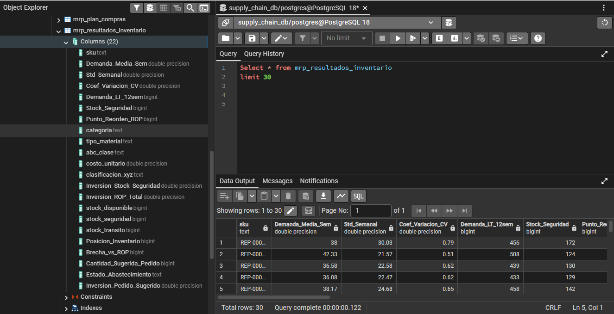

# 📦 Automatización del Motor MRP y Optimización de Inventarios (Supply Chain)

Pipeline integral (**ETL + Machine Learning + Business Intelligence**) diseñado para automatizar el cálculo de políticas de inventario, proyección de demanda y generación de órdenes de compra sugeridas (MRP), conectando **Python**, **PostgreSQL** y **Power BI**.

---

## 🏗️ Arquitectura de Datos Autoactualizable

El flujo está diseñado para operar de forma autónoma en un entorno productivo:

1. **Extracción (PostgreSQL -> Python):** El motor consulta directamente las tablas transaccionales y maestras (`ventas_historicas`, `inventario_actual`, `maestro_productos`) en PostgreSQL.
2. **Procesamiento y Lógica Matemática (Python):** Ejecuta limpieza de datos, segmentación ABC-XYZ, modelado predictivo y cálculo dinámico de puntos de reorden.
3. **Carga y Persistencia (Python -> PostgreSQL):** Al finalizar, el script vuelca automáticamente los resultados consolidados en la tabla `mrp_resultados_inventario` mediante SQLAlchemy (`to_sql`), además de generar un respaldo en formato CSV.
4. **Visualización en Tiempo Real (Power BI):** Conectado de forma nativa a PostgreSQL, permitiendo actualizar los tableros de control y alertas de reabastecimiento con un solo clic (*Refresh*), sin depender de archivos planos estáticos.

### 📸 Arquitectura POSTGRESQL_MRP (`mrp_resultados_inventario`)

---

## 🔬 Estudio, Metodología y Comparación de Modelos

El motor implementa un enfoque híbrido que combina **lógica determinista de gestión de inventarios** con **Machine Learning** para la predicción de la demanda:

### 1. Auditoría y Tratamiento de Outliers (Capping por SKU)
* Se aplica un límite superior basado en el rango intercuartílico ($Q3 + 1.5 \times IQR$) evaluado de forma independiente por cada SKU.
* Se establece un **piso mínimo operativo de 150 unidades** para evitar distorsiones por picos atípicos sin penalizar artículos de rotación base.

### 2. Segmentación Multicriterio ABC-XYZ
* **Clasificación ABC:** Vinculada al impacto financiero y valor de consumo de los materiales.
* **Clasificación XYZ:** Basada en la estabilidad de la demanda medida mediante el Coeficiente de Variación ($CV = \sigma / \mu$), fijando un umbral de **$CV \le 0.4$** para clasificar los artículos altamente estables como **Clase X**, entre $0.4$ y $1.0$ como **Clase Y**, y superiores a $1.0$ como **Clase Z**.

### 3. Modelado Predictivo (LightGBM vs. Suavizado Exponencial)
* Se evaluó el desempeño de modelos de Machine Learning (**LightGBM** entrenado con variables temporales: categoría, mes, día del año y año) frente a métodos estadísticos clásicos (**Holt-Winters**).
* **Validación y Estacionalidad:** LightGBM demostró mayor capacidad para capturar patrones estacionales marcados (como el comportamiento cíclico en la categoría *Frenos* durante el cierre e inicio de año), validando su precisión mediante **Bias (Sesgo Global)** y **MAPE (Error Porcentual Absoluto Medio)**.

### 4. Parámetros Logísticos de Reabastecimiento (MRP)
* **Lead Time:** Configurado a **12 semanas** para abastecimiento internacional.
* **Nivel de Servicio:** **95%** ($Z = 1.65$) aplicado sobre la desviación estándar semanal para dimensionar el Stock de Seguridad ($SS = Z \cdot \sigma \cdot \sqrt{LT}$).
* **Cálculo de Brechas y Alertas:** Cruce entre el Punto de Reorden ($ROP$) y la Posición de Inventario (Stock Disponible + Tránsito) para calcular la `Cantidad_Sugerida_Pedido`, el presupuesto requerido y el estado de alerta (`🚨 REORDENAR` / `✅ OK`).

---

## 🛠️ Stack Tecnológico

* **Lenguaje:** Python 3.14 (`pandas`, `numpy`, `scikit-learn`, `lightgbm`, `statsmodels`, `sqlalchemy`, `psycopg2`)
* **Base de Datos:** PostgreSQL
* **Visualización:** Power BI Desktop, Plotly, Seaborn, Matplotlib
* **Control de Versiones:** Git & GitHub